<div align="center">



<a href="https://github.com/MustafArikan">
  
</a>

<br/>

<a href="https://www.linkedin.com/in/mustafa-ar%C4%B1kan/"></a>
<a href="mailto:arikanmustafa@gmail.com"></a>
<a href="https://github.com/MustafArikan?tab=repositories"></a>


</div>

---

## 👋 About me

I'm a **senior Computer Engineering student at KTO Karatay University** (class of 2027) based in **Konya, Türkiye**, focused on **machine learning, NLP and computer vision**, with the backend and DevOps skills to take models all the way to production.

Over **three internship terms at Deva Yazılım Entegre Çözümler** I built a multilingual ticket-triage model and a flood early-warning system, and I enjoy digging into *why* a model behaves the way it does: evaluation, error analysis and explainability.

```python
class MustafaArikan:
    role      = "Computer Engineering student → AI / ML engineer"
    focus     = ["NLP", "Computer Vision", "Time-Series", "MLOps"]
    languages = ["Python", "C#", "TypeScript", "SQL", "Java", "C/C++"]
    learning  = ["LLM fine-tuning (LoRA)", "Production ML on Kubernetes"]
    looking_for = "AI / ML / Data Science roles"

    def motto(self):
        return "Measure first, then optimise. And always check for confounders."
```

---

## 🧰 Tech stack

<div align="center">


<br/>


</div>

<details>
<summary><b>🔎 Click for the full skill breakdown</b></summary>
<br/>

| Area | Skills |
|---|---|
| 🤖 **AI & ML** | Machine Learning, Deep Learning, NLP, Computer Vision, Transfer Learning, Time-Series Forecasting, Feature Engineering, Model Explainability (SHAP / LIME), Signal Processing |
| 🧪 **ML tools** | PyTorch, TensorFlow, Keras, Hugging Face Transformers, scikit-learn, XGBoost, MLflow, pandas, NumPy, SciPy, Streamlit, EPA SWMM, PySWMM |
| ⚙️ **Backend & data** | ASP.NET Core (MVC & Web API), FastAPI, Entity Framework Core, REST, JWT, SQL Server, SQLite |
| 🎨 **Frontend** | React, HTML, CSS, Tailwind CSS, Bootstrap 5, Razor Views, Chart.js |
| 🚢 **DevOps** | Git, Docker, Docker Compose, Kubernetes, GitHub Actions, Prometheus, Grafana, Loki |
| 🔌 **Fundamentals** | Microprocessors, Signals & Systems, Circuit Theory, Digital Systems |

</details>

---

## 💼 Experience

> 👇 Click each role to expand it.

<details open>
<summary><b>🧠 Computer Engineering Intern: ML &amp; MLOps</b> · Deva Yazılım Entegre Çözümler · <i>Jun 2026 – Aug 2026</i></summary>
<br/>

**Multilingual support-ticket triage (EN / DE / TR)**

- Designed and trained a **multi-task mBERT** model that predicts ticket type, queue, category and priority in **one forward pass**, on a cleaned **32.7K-ticket corpus** (Hugging Face EN/DE data plus Turkish samples synthesized with a local Ollama LLM). Focal loss improved detection of the rare *Critical* class.
- Benchmarked TF-IDF baselines (LinearSVC, Random Forest, Logistic Regression) against fine-tuned **BERT and XLM-RoBERTa (incl. LoRA)**, tracked with **MLflow**. XLM-RoBERTa reached **~0.87 macro-F1** on category and **~0.78** on priority.
- Found a **language confound** (Critical tickets existed only in the synthetic Turkish data) and neutralised it with stratified, customer-grouped splits. Diagnosed a **checkpoint-selection bug** that understated per-task scores by **10–14 points**, and harmonised the label schema, lifting Turkish priority macro-F1 from **0.54 → 0.64**.
- Deployed as **FastAPI microservices on Kubernetes** with CPU/memory autoscaling validated by Locust, Prometheus / Grafana / Loki monitoring, KS-test drift detection and GitHub Actions CI. SHAP / LIME explanations are served with **sub-200 ms inference**.

</details>

<details>
<summary><b>🌊 Computer Engineering Intern (Part-time): Flood early warning</b> · Deva Yazılım Entegre Çözümler · <i>Sep 2025 – Dec 2025</i></summary>
<br/>

- Built a **flood simulation pipeline** with **EPA SWMM and PySWMM**: it generates SWMM input files in Python from DEM elevation data, runs rainfall-runoff simulations, exports node-depth and conduit-flow time series, and classifies flood risk into three levels (Low / Medium / High).
- Engineered an **ML-based early-warning system** on the simulation data that issues warnings **30–45 minutes in advance with an 81% success rate**.

</details>

<details>
<summary><b>🧩 Computer Engineering Intern: Full-stack</b> · Deva Yazılım Entegre Çözümler · <i>Jul 2025 – Sep 2025</i></summary>
<br/>

- Created **InternTracker**, a full-stack internship management platform (ASP.NET Core MVC, C#, EF Core, SQL Server) with **7 controllers, 55 Razor views, 8 domain entities and 12 schema migrations**.
- Added three-role authorization (Admin / Mentor / Intern), task and goal tracking, journal logging, in-app notifications, Chart.js dashboards and access-controlled file sharing.

</details>

---

## 🚀 Featured projects

<table>
<tr>
<td width="50%" valign="top">

### 🎫 [Multilingual Ticket Classification](https://github.com/MustafArikan/Support-Ticket-Classification-and-Priority-Prediction)
Full pipeline (EDA → baselines → transformer fine-tuning) for EN / DE / TR tickets. Multi-task BERT / XLM-R with a cascade head, an ordinal priority head and class-weighted losses.


**0.85** macro-F1 on ticket type

</td>
<td width="50%" valign="top">

### ⚡ [Smart Grid Energy Forecasting](https://github.com/MustafArikan/smart-grid-energy-forecasting)
Team of 8. I led algorithm development, training and EDA on hourly Denmark DK1 grid, price and weather data: 40+ features, 1h–168h lags and recursive 24-hour forecasting, served in a multi-page Streamlit dashboard.


**R² 0.97** · MAE 44.6 MWh

</td>
</tr>
<tr>
<td width="50%" valign="top">

### 📦 [StockFlow](https://github.com/MustafArikan/StockFlow)
Multi-warehouse inventory and asset platform: ASP.NET Core 10 REST API (17 controllers), JWT with session revocation, database-driven RBAC (50+ permissions), ACID stock movements, optimistic concurrency, hybrid EAV/JSON attributes, QR/barcode scanning and a 12-service Docker Compose stack with full observability.


</td>
<td width="50%" valign="top">

### 🎮 [Video Game Hit Predictor](https://github.com/MustafArikan/video-game-hit-predictor)
50/50 ensemble of a Keras DNN and XGBoost predicting whether a game sells over 1M copies, with SMOTE, target encoding, RandomizedSearchCV and F1-optimised thresholding.


**~84–86%** accuracy · **~0.90–0.92** AUC-ROC

</td>
</tr>
<tr>
<td width="50%" valign="top">

### 🍅 [Plant Disease Detection](https://github.com/MustafArikan/Plant-Disease-Detection-with-Deep-Learning)
MobileNetV2 transfer learning on PlantVillage to classify ten tomato leaf conditions, with a custom head, augmentation, confusion matrices and per-class metrics.


**~85%** validation accuracy

</td>
<td width="50%" valign="top">

### 💓 [Biomedical ECG Signal Processing](https://github.com/MustafArikan/Biomedical-Ecg-Signal-Processing)
Simulated 50 Hz powerline, baseline-wander and sensor noise, then restored ECG signals with an IIR notch filter and a 4th-order Butterworth band-pass (0.5–40 Hz), validating QRS peak detection beat by beat with SNR-gain analysis.


</td>
</tr>
</table>

<details>
<summary><b>📚 More experiments</b></summary>
<br/>

- 🌧️ **Australian Rain Prediction & Explainability**: MICE imputation, SelectKBest / SelectFromModel, Random Forest and XGBoost, interpreted with ELI5 permutation importance.
- ⭐ **Star Type Classification**: KNN vs Decision Tree vs Random Forest on 240 stars (6 classes) with stratified k-fold CV and learning curves.

</details>

---

## 📊 GitHub stats

<div align="center">


<br/>


</div>

### 🐍 Contribution snake

<div align="center">

<picture>
  <source media="(prefers-color-scheme: dark)" srcset="https://raw.githubusercontent.com/MustafArikan/MustafArikan/output/github-snake-dark.svg"/>
  <source media="(prefers-color-scheme: light)" srcset="https://raw.githubusercontent.com/MustafArikan/MustafArikan/output/github-snake.svg"/>
  
</picture>

</div>

---

## 🎓 Education & courses

- 🎓 **B.Sc. Computer Engineering**, KTO Karatay University (expected 2027)
- 📜 *Supervised Machine Learning: Regression and Classification* (Sep 2025)
- 📜 *Introduction to AI and Machine Learning on Google Cloud* (Nov 2024)
- 📜 *Google Cybersecurity* (Sep 2024)

---

<div align="center">

### 🤝 Let's build something together

I'm looking for **AI / ML / Data Science** opportunities. Feel free to reach out!

<a href="https://www.linkedin.com/in/mustafa-ar%C4%B1kan/"></a>


</div>
